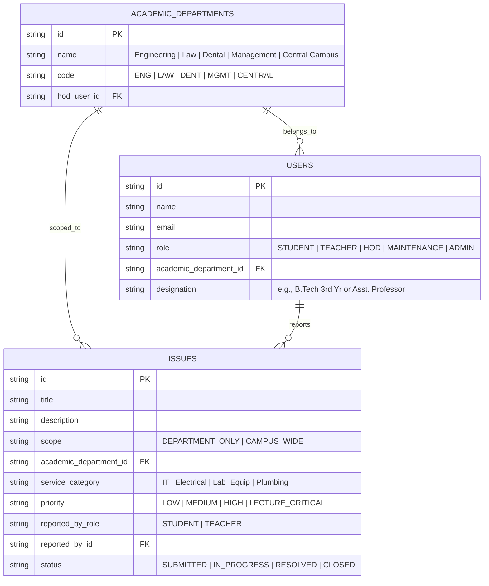

# 🏛️ CampusFix: Academic Department Scoping & Multi-Faculty Architecture

## 1. System Vision & Architecture

In a university or large college, students and faculty belong to different academic schools (such as **Engineering, Law, Dental, Management, Pharmacy, Arts**). 

The platform uses a **2-Tier Scoping Model**:
1. **Department-Specific Scope (Isolated)**: Issues concerning a specific faculty (e.g., Dental clinic chairs, Law moot court sound system, Engineering CAD/CNC lab machines) remain strictly confined to that department. Students and teachers from other departments are not spammed.
2. **Whole-College / Campus-Wide Scope**: Issues in shared university infrastructure (Central Canteen, Central Library, University Buses, Sports Grounds, Campus Wi-Fi, University Hostels) are visible to all students and teachers university-wide.

```mermaid
graph TD
    subgraph Campus_Level ["🏛️ Whole-College / Central Level (Visible to ALL)"]
        CentralFeed["Universal Campus Feed (Central Library, Canteen, Buses, Hostels)"]
        UnivAdmin["University Super Admin / Dean of Academics"]
        CentralMaint["Central Maintenance Team (Electricians, Plumbers, Central IT)"]
    end

    subgraph Dept_Engg ["⚙️ Engineering Department"]
        EnggStudents["Engg Students"]
        EnggFaculty["Engg Teachers"]
        EnggHOD["Engg HOD / Lab In-Charge"]
        EnggFeed["Engg Private Issue Feed (Labs, Workshops, Classrooms)"]
    end

    subgraph Dept_Law ["⚖️ Law Department"]
        LawStudents["Law Students"]
        LawFaculty["Law Teachers"]
        LawHOD["Law HOD / Dean"]
        LawFeed["Law Private Issue Feed (Moot Court, Legal Library)"]
    end

    subgraph Dept_Dental ["🦷 Dental / Medical Department"]
        DentalStudents["Dental Students"]
        DentalFaculty["Dental Teachers"]
        DentalHOD["Dental Clinic Head"]
        DentalFeed["Dental Private Feed (Patient Chairs, X-Ray, Sterilization)"]
    end

    subgraph Dept_Physio ["🏃 College of Physiotherapy (BPT / MPT)"]
        PhysioUsers["Physiotherapy Students & Faculty"]
        PhysioHOD["Physiotherapy Principal / Clinic Head"]
        PhysioFeed["Physio Feed (Electrotherapy IFT, Traction Tables, Rehab Gym)"]
    end

    subgraph Dept_Sciences ["🔬 School of Basic & Applied Sciences (B.Sc. / M.Sc.)"]
        SciUsers["B.Sc. & M.Sc. Students & Faculty"]
        SciHOD["Sciences HOD / Lab In-Charge"]
        SciFeed["Sciences Private Feed (Fume Hoods, Optics Darkroom, Distilled Water)"]
    end

    subgraph Dept_Masters ["🎓 Postgraduate / Masters Center (M.Tech, MBA, LLM)"]
        MastersUsers["Masters Students & Faculty"]
        MastersHOD["Dean of PG Studies"]
        MastersFeed["Masters Private Feed (PG Seminar Halls, Thesis Presentation Labs)"]
    end

    subgraph Dept_PhD ["🧪 Doctoral Research & Ph.D. Scholar Wing"]
        PhDUsers["Ph.D. Scholars & Research Guides"]
        PhDHOD["Dean of Research / CIF In-Charge"]
        PhDFeed["Ph.D. Private Feed (24x7 Cubicles, CIF Instruments, SEM/XRD, Chillers)"]
    end

    EnggStudents & EnggFaculty --> EnggFeed
    LawStudents & LawFaculty --> LawFeed
    DentalStudents & DentalFaculty --> DentalFeed
    PhysioUsers --> PhysioFeed
    SciUsers --> SciFeed
    MastersUsers --> MastersFeed
    PhDUsers --> PhDFeed

    EnggFeed --> EnggHOD
    LawFeed --> LawHOD
    DentalFeed --> DentalHOD
    PhysioFeed --> PhysioHOD
    SciFeed --> SciHOD
    MastersFeed --> MastersHOD
    PhDFeed --> PhDHOD

    EnggHOD & LawHOD & DentalHOD & PhysioHOD & SciHOD & MastersHOD & PhDHOD --> CentralMaint
    CentralFeed --> UnivAdmin
```



---

## 2. User Roles & Department Association

Every user profile is linked to an **Academic Department** and a **Role**:

| Role | Department Scope | Capabilities |
| :--- | :--- | :--- |
| **Student** | Tagged to their school (e.g., *Engineering*, *Law*, *Dental*) | Report department issues, upvote department peers' issues, view shared campus issues. |
| **Teacher / Faculty** | Tagged to their school (e.g., *Associate Professor - Law*) | Raise issues with a **"Lecture Critical"** fast-track priority, report classroom/lab equipment faults, verify completed repairs. |
| **Department HOD / Lab In-Charge** | Department Lead (e.g., *HOD Computer Science*, *Clinic Head Dental*) | Oversees their department's issues, assigns internal lab assistants or forwards to central maintenance. |
| **Central Maintenance Staff** | University-Wide Trades (Electricians, Plumbers, Network Techs) | Receives dispatched tickets across departments, uploads before/after photo proof. |
| **University Super Admin** | Central University (Registrar / Dean of Infrastructure) | Full bird's-eye view of all departments, performance benchmarking, university-wide announcements. |

---

## 3. The 2-Tier Scoping & Feed Isolation Engine

### A. Department-Specific Scope (Department Isolation)
- **Automatic Feed Filtering:**
  - An **Engineering** student sees only Engineering classrooms, labs, and workshop issues.
  - A **Law** student sees only Law moot courts, legal research labs, and law seminar halls.
  - A **Dental** student sees only dental clinic chairs, sterilization autoclaves, and phantom head lab issues.
  - A **Physiotherapy (BPT / MPT)** student/faculty sees only Electrotherapy (IFT, Ultrasound, TENS), Traction beds, and Rehabilitation Gym equipment issues.
  - A **Sciences (B.Sc. / M.Sc.)** student/faculty sees only Chemistry wet labs (fume hoods, gas pipes), Physics darkrooms/optics, and Biology microscope/incubation facilities.
  - A **Postgraduate / Masters (PG)** student/faculty sees dedicated Masters seminar halls, PG computational labs, and thesis presentation rooms.
  - A **Ph.D. / Research Scholar** sees only 24x7 scholar workstation cubicles, high-performance computing clusters, and Central Instrumentation Facilities (CIF - SEM, XRD, NMR, chillers).
- **Privacy & Relevancy:** Prevents information overload and clutter across faculties.
- **Internal Department Escalation:** If a lab machine is broken, it first notifies the **Department Lab Assistant / HOD**. If unresolved within 24 hours, it auto-escalates to the University Central Maintenance Team.

### B. Whole-College / Campus-Wide Scope (Universal Access)
- **Shared Facilities Module:** 
  - Central Library
  - University Canteens & Food Courts
  - Campus Transport & Bus Routes
  - University Sports Grounds / Gym
  - Common Hostels & Mess
  - Main Administrative Block & Registrar Office
- **Universal Upvoting:** Any student or teacher from *any* department can upvote shared issues (e.g., "Water cooler broken in Central Library 2nd floor").

---

## 4. Teacher / Faculty Specific Features

Teachers experience different classroom and lab constraints than students, so the platform equips them with specialized features:

1. **"Lecture-Critical" Instant Priority Tag:**
   * When a teacher reports an issue during class hours (e.g., *Projector bulb blown in Lecture Hall 301*, *Mic not working during class*), marking **"Lecture in Progress"** immediately triggers an urgent SMS/notification to the duty technician for a **15-minute response SLA**.
2. **Lab & Classroom Repair Sign-Off:**
   * Once a technician marks a departmental lab or classroom issue as fixed, the **Subject Teacher or Lab In-Charge** must approve the fix before the ticket is officially closed.
3. **Faculty Private Notes:**
   * Teachers can add confidential remarks on a ticket (e.g., *"Student reported safety hazard with autoclave heating coil — recommend immediate inspection"*).
4. **Faculty Room & Staff Lounge Issue Reporting (Confidential / Staff-Only):**
   * **Private Scope (Hidden from Students):** Teachers can report issues occurring in their **Faculty Room, Staff Cabins, HOD Chamber, or Staff Lounge**. These tickets are strictly hidden from student feeds to preserve faculty privacy.
   * **Dedicated Staff Room Categories:**
     - **IT & Office Equipment:** Staff room networked heavy-duty printer/scanner breakdown, cartridge replacement, high-speed faculty LAN ports.
     - **Cabin Infrastructure & Comfort:** Faculty cabin AC not cooling, fan regulator, lighting, power socket near work desk.
     - **Lounge Amenities:** Staff lounge water dispenser (hot/cold), microwave, electric kettle, refrigerator.
     - **Furniture & Carpentry:** Ergonomic chair wheel/piston repair, book cabinet locks, damaged workstation drawers.
     - **Staff Washroom Hygiene:** Dedicated staff washroom sanitation, liquid soap refill, water pressure.
   * **Teacher Availability Window for Technician Visit:**
     - Teachers can specify their free lecture slots (e.g., *"Available for technician visit between 1:00 PM – 2:30 PM or post 4:00 PM"*), ensuring technicians do not disturb teachers while they are grading exams or meeting students.

---

## 5. Dual-Axis Issue Classification

When creating an issue, the system captures two axes:

```
[ Academic Department / Scope ]    x    [ Service Category ]
---------------------------------       ----------------------
• Engineering (CSE, Mech, Civil)        • Electrical & AC
• Law                                   • IT / Computer / Projector
• Dental / Medical                      • Lab Equipment / Machinery
• Management (MBA / BBA)                • Plumbing & Washrooms
• Pharmacy                              • Furniture & Carpentry
• Central Campus (Library/Canteen/Bus)  • Cleaning & Hygiene
```

### Examples:
| Issue Title | Academic Department | Service Category | Visibility |
| :--- | :--- | :--- | :--- |
| "Dental Chair 3 hydraulic foot pedal stuck" | **Dental** | Lab / Medical Equipment | **Dental Faculty & Students** |
| "Ultrasound Therapy machine output intensity error" | **Physiotherapy (BPT/MPT)**| Clinical / Electrotherapy | **Physiotherapy Faculty & Students** |
| "Moot Court wireless collar mic has heavy noise" | **Law** | IT & Audio-Visual | **Law Faculty & Students** |
| "CNC Milling machine spindle error" | **Engineering** | Workshop Machinery | **Engineering Faculty & Students** |
| "Chemistry Lab 2 fume hood exhaust fan stopped" | **Sciences (BSc/MSc)** | Lab Equipment / Ventilation | **Sciences Faculty & Students** |
| "Masters Seminar Hall projector aspect ratio distorted" | **Masters (PG Center)**| IT & Audio-Visual | **Masters Faculty & Students** |
| "Ph.D. Scholar Cubicle #14 24x7 UPS power trip" | **Ph.D. Research Wing** | Electrical / 24x7 Power | **Ph.D. Scholars & Guides Only** |
| "Law Faculty Room heavy-duty printer paper jam" | **Law** | Faculty Room / IT | **Law Teachers & Staff Only (Hidden from Students)** |
| "Engg Staff Lounge microwave sparking" | **Engineering** | Faculty Room / Appliance | **Engg Teachers & Staff Only (Hidden from Students)** |
| "Central Canteen water filter tasting metallic" | **Central Campus** | Canteen / Plumbing | **Whole College (All)** |
| "College Bus Route #4 AC not working" | **Central Campus** | Transport / Fleet | **Whole College (All)** |

---

## 6. Database Schema Adaptations for Academic Departments


