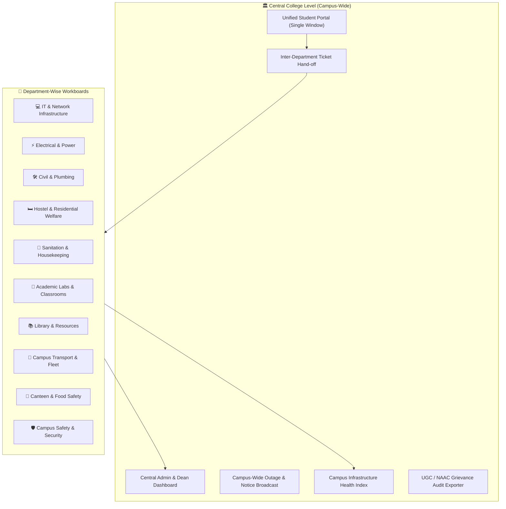

# 🏛️ CampusFix: Central Campus & Department-Wise Feature Specification

This specification defines the multi-tiered architecture of **CampusFix**, dividing features into:
1. **Whole College (Central Campus-Wide) Level** — Institutional governance, unified student portal, inter-department routing, and campus-wide broadcasting.
2. **Department-Wise Level** — Tailored workflows, asset tracking, and custom SLAs for 10 individual campus departments.

---

---

## Part 1: Whole College (Central Campus-Wide) Features

### 1.1 Unified Single-Window Student Portal
- **Concept:** Students do not need to figure out which physical office or administration wing to visit.
- **Smart Category Router:** The student inputs the issue; the system automatically detects and dispatches it to the appropriate department.
- **Campus Public Feed:** A timeline of non-confidential issues campus-wide, allowing upvoting across batches and branches to avoid duplicate tickets.

### 1.2 Central Executive Dashboard (Principal / Dean / Estate Officer)
- **Bird’s Eye View:** Real-time visibility into all 10 departments simultaneously.
- **Department Performance League Table:** Compares departments by:
  - Resolution rate (%)
  - Average Turnaround Time (TAT)
  - SLA breach frequency
  - Student satisfaction rating (1–5 stars)
- **Bottleneck Alarms:** Instantly highlights departments with $>15$ overdue tickets.

### 1.3 Campus-Wide Maintenance & Outage Broadcasts
- **Proactive Announcements:** When a planned power outage, Wi-Fi maintenance, or water tank cleaning is scheduled, central admin can publish a campus broadcast banner.
- **Auto-Suppression:** While an outage notice is active (e.g., "Main Server Maintenance 2 PM–5 PM"), incoming duplicate tickets for that asset/zone are automatically grouped under the announcement.

### 1.4 Inter-Department Composite Ticket Hand-Off
- **Cross-Department Collaboration:** Complex campus issues often require multiple trades.
  - *Example:* A water pump failure requires both **Civil (Plumber)** to check pipes and **Electrical (Electrician)** to repair the motor.
- **Multi-Assignee Support:** A ticket can have a primary department and secondary collaborating department, with shared activity logs.

### 1.5 Campus Infrastructure Health Index & Heatmap
- **Health Score (0–100%):** Calculated dynamically for each Campus Block (e.g., *Science Block: 94% Healthy*, *Hostel 3: 72% - Attention Required*).
- **Interactive Floor Map / Block View:** Visual representation where color-coded indicators (Green/Yellow/Red) highlight ongoing maintenance clusters.

### 1.6 Statutory & Accreditation Audit Exporter (NAAC / NBA / UGC)
- Automated one-click PDF generation of statutory reports:
  - Total Grievances Received vs. Redressed.
  - Time-to-Resolution Distribution.
  - Zero-Pending Disciplinary/Ragging Compliance Certificates.

---

## Part 2: Department-Wise Feature Specifications

---

### 1. 💻 IT & Campus Network Department
*Responsible for campus Wi-Fi, computer labs, smart classroom projectors, audio systems, and student email accounts.*

* **Sub-Categories:**
  - Wi-Fi Access Point dead zones / login issues.
  - Computer lab hardware faults (mouse, keyboard, monitor, RAM).
  - Smart classroom projector & HDMI cable faults.
  - Campus Portal / LMS login credentials.
* **Department-Specific Features:**
  - **MAC / IP / Asset ID Field:** Student can enter PC Number (e.g., `Lab-3-PC-18`).
  - **Ping / Network Status Integration:** Quick indicator showing if the block AP is offline.
  - **Standard SLA:** 4–8 hours for classroom projectors; 24 hours for lab PCs.

---

### 2. ⚡ Electrical & Power Department
*Responsible for power supply, wiring, fans, lights, air conditioning, and diesel generator backups.*

* **Sub-Categories:**
  - Tube light / LED panel replacement.
  - Ceiling fan / AC not cooling / remote missing.
  - Switchboard sparking / loose socket.
  - Corridor / streetlight darkness.
* **Department-Specific Features:**
  - **Hazard Warning Tag:** Issues marked `Sparking` or `Exposed Wire` automatically trigger an **Emergency** audio/SMS alert to duty electricians.
  - **Spare Part Inventory Tracker:** Electricians record consumed components (e.g., "1x 36W LED Tube, 1x 16A MCB") upon resolving the ticket.
  - **Standard SLA:** 2 hours for electrical hazards; 24 hours for regular replacements.

---

### 3. 🛠️ Civil, Plumbing & Infrastructure Department
*Responsible for building masonry, water supply, washroom fittings, carpentry, and furniture.*

* **Sub-Categories:**
  - Tap leakage / flush malfunction / no water in tank.
  - Broken classroom desk / podium / door hinge / window glass.
  - Water seepage / wall peeling.
* **Department-Specific Features:**
  - **Water Supply Urgent Dispatch:** Water shortage tickets in hostels bypass triage and alert the pump operator directly.
  - **Before & After Photo Requirement:** Plumbers and carpenters must upload a photo of the completed repair.
  - **Standard SLA:** 4 hours for washroom water leaks; 48 hours for carpentry/furniture repairs.

---

### 4. 🛏️ Hostel & Residential Welfare (Warden / Caretaker)
*Responsible for student hostels, mess amenities, room allotments, and residential security.*

* **Sub-Categories:**
  - Room furniture / bed / cupboard lock issues.
  - Geyser / hot water unavailability in winter.
  - Water cooler filter contamination / warm drinking water.
  - Common room TV / recreation equipment.
* **Department-Specific Features:**
  - **Hostel Block & Room Filter:** Wardens can filter tickets specifically for *Hostel Block A, Floor 2*.
  - **Room Inspection Permission:** Student can specify an entry availability window (e.g., *"Available after 5:00 PM for technician entry"*).
  - **Standard SLA:** 6 hours for geyser/drinking water; 24 hours for room fixtures.

---

### 5. 🧹 Sanitation & Housekeeping Department
*Responsible for washroom hygiene, waste collection, corridor sweeping, and pest control.*

* **Sub-Categories:**
  - Dirty washroom / missing soap or toilet paper.
  - Overflowing garbage bins in canteen or department corridors.
  - Pest infestation (mosquitoes, termites, stray animals).
* **Department-Specific Features:**
  - **Sanitation Inspection Checklist:** Housekeeping supervisor performs daily digital rounds and signs off on floor cleanliness.
  - **Fast-Track SLA:** 2 hours for unhygienic washroom complaints.

---

### 6. 🔬 Academic Labs & Classrooms Department
*Responsible for specialized lab equipment, chemical storage, workshop machinery, and lecture hall mics.*

* **Sub-Categories:**
  - Chemistry lab exhaust / fume hood not working.
  - Mechanical workshop lathe / 3D printer calibration issue.
  - Lecture hall podium microphone / sound amplifier static.
* **Department-Specific Features:**
  - **Lab Assistant Sign-Off:** Repairs must be verified by the relevant Lab Assistant / Course Faculty before closing.
  - **Standard SLA:** 12 hours for lecture hall audio equipment; 48 hours for lab machinery.

---

### 7. 📚 Library & Learning Resources
*Responsible for central library infrastructure, digital kiosks, and quiet study zones.*

* **Sub-Categories:**
  - OPAC book search terminal offline.
  - RFID turnstile entry gate malfunction.
  - Noise complaints in silent study areas.
  - Air conditioning in reading hall.
* **Department-Specific Features:**
  - **Anonymous Noise Alert:** Students studying in the library can report noise anonymously to the duty librarian without confrontation.
  - **Standard SLA:** Immediate for noise; 24 hours for kiosk hardware.

---

### 8. 🚌 Campus Transport & Fleet Management
*Responsible for college buses, shuttles, and campus parking facilities.*

* **Sub-Categories:**
  - College bus delay / route skipped without prior notice.
  - AC / window rattle / seat broken in bus number X.
  - Illegal parking blocking campus gates or wheelchair ramps.
* **Department-Specific Features:**
  - **Bus Route & Vehicle Number Selector:** Complaints link directly to specific bus license plates and driver rosters.
  - **Standard SLA:** 24 hours for fleet maintenance; immediate for route dispatch.

---

### 9. 🍲 Canteen, Cafeteria & Food Services
*Responsible for campus dining hygiene, food quality, pricing, and seating.*

* **Sub-Categories:**
  - Food quality or hygiene issue (e.g., foreign particles, undercooked food).
  - Drinking water dispenser hygiene.
  - Overcharging beyond college-regulated price menu.
* **Department-Specific Features:**
  - **Food Safety Escalation:** Any food hygiene report automatically flags the Canteen Committee and Student Council President.
  - **Standard SLA:** 4 hours for food quality inspections.

---

### 10. 🛡️ Campus Safety, Security & Confidential Grievances
*Responsible for campus physical security, entry gates, CCTV cameras, and anti-ragging compliance.*

* **Sub-Categories:**
  - Dark spots / non-functional streetlights on pedestrian pathways.
  - CCTV camera blind spots or non-working cameras.
  - Confidential reports (Ragging, Bullying, Discrimination, Harassment).
* **Department-Specific Features:**
  - **Vault-Level Privacy (End-to-End Encryption):** Confidential issues are locked from regular staff and visible exclusively to the designated **Anti-Ragging / Internal Complaints Committee (ICC)**.
  - **Zero-Tolerance SLA:** Immediate response within 2 hours.

---

## 📊 Summary Comparison: Department SLAs & Workflows

| Department | Typical Key Assets | Primary User in Charge | Default Urgent SLA |
| :--- | :--- | :--- | :--- |
| **IT & Network** | Routers, Lab PCs, Projectors | Network Admin / Systems Engineer | 4 Hours |
| **Electrical** | Switchboards, Lights, Generators, ACs | Junior Engineer (Electrical) | 2 Hours |
| **Civil & Plumbing** | Water tanks, Taps, Desks, Doors | Junior Engineer (Civil) / Plumber | 4 Hours |
| **Hostel Welfare** | Geysers, Water Coolers, Locks | Chief Warden / Hostel Caretaker | 6 Hours |
| **Sanitation** | Washrooms, Dustbins, Cleaning | Housekeeping Supervisor | 2 Hours |
| **Academic Labs** | Fume hoods, Machines, Lab PCs | Lab In-Charge / Assistant | 12 Hours |
| **Library** | RFID gates, OPAC PCs, AC | Chief Librarian | 24 Hours |
| **Transport** | Buses, Shuttles, Parking Lots | Transport Officer | 24 Hours |
| **Canteen** | Food preparation, Water, Seating | Canteen Committee / Food Inspector| 4 Hours |
| **Campus Security**| CCTV, Boundary, Anti-Ragging | Chief Security Officer / Dean | **Immediate (<2 hrs)**|
