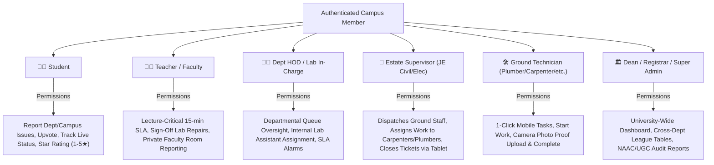
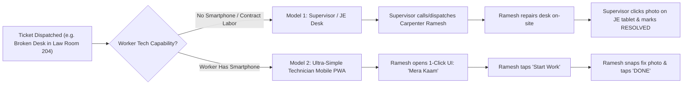
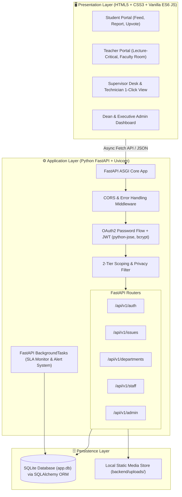
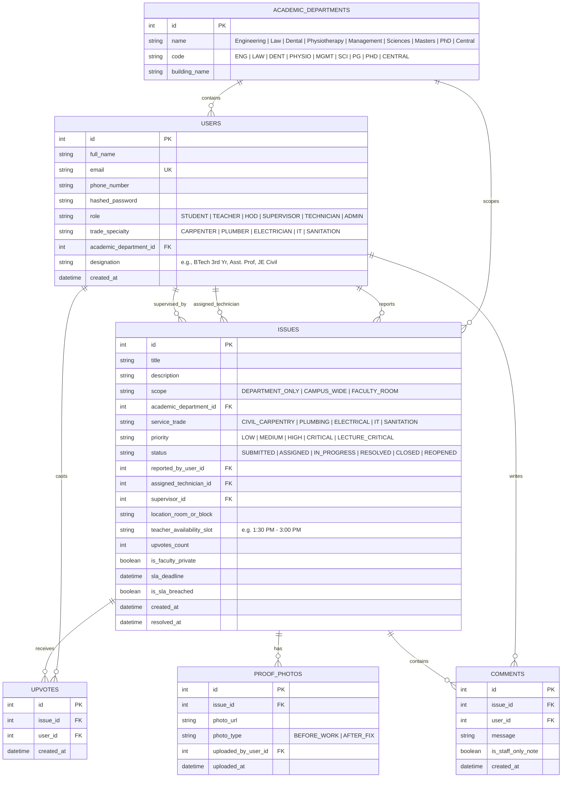

# 🏛️ CampusFix — Master System Design & Architecture Document

> **The Unified College Project Specification & Design Blueprint**  
> **Tech Stack:** HTML5 / CSS3 / JavaScript (Frontend) + Python FastAPI (Backend) + SQLite / SQLAlchemy (Database)

---

## 📑 Table of Contents
1. [Executive Summary & Core Philosophy](#1-executive-summary--core-philosophy)
2. [Academic Department Isolation (Multi-Faculty Architecture)](#2-academic-department-isolation-multi-faculty-architecture)
3. [Actor Hierarchy & Role Privileges](#3-actor-hierarchy--role-privileges)
4. [Specialized Teacher & Faculty Workflows](#4-specialized-teacher--faculty-workflows)
5. [Ground Staff Operations: The Hybrid Dispatch Engine](#5-ground-staff-operations-the-hybrid-dispatch-engine)
6. [Dual-Axis Classification & Visibility Matrix](#6-dual-axis-classification--visibility-matrix)
7. [Technical Architecture (HTML/CSS/JS + FastAPI)](#7-technical-architecture-htmlcssjs--fastapi)
8. [Database Schema Design (Entity-Relationship)](#8-database-schema-design-entity-relationship)
9. [RESTful API Endpoint Specification](#9-restful-api-endpoint-specification)
10. [Frontend UI Wireframe Layouts](#10-frontend-ui-wireframe-layouts)
11. [Project Directory Structure](#11-project-directory-structure)
12. [College Viva & Presentation Guide](#12-college-viva--presentation-guide)

---

## 1. Executive Summary & Core Philosophy

**CampusFix** is a unified, production-grade issue resolution and facility management platform designed specifically for college and university campuses. It addresses real-world college dynamics by solving four critical pain points:

1. **No Cross-Department Clutter:** Academic complaints are strictly scoped to the student's and teacher's specific school (Engineering, Law, Dental, Physiotherapy, Sciences, Masters, Ph.D.). A broken lathe machine in Engineering will **never** disturb a Law or Dental student.
2. **Whole-College Shared Infrastructure:** Central university amenities (Central Library, Main Canteens, College Buses, Sports Grounds, Common Hostels) are open campus-wide for universal reporting and upvoting.
3. **Faculty & Classroom Protection:** Teachers can trigger an urgent **15-minute "Lecture-Critical" SLA** during classes, sign off on lab repairs, and privately report **Faculty Room & Staff Cabin issues** completely hidden from students.
4. **All-Inclusive Ground Staff Operations:** Real-world workers (carpenters, plumbers, electricians, sweepers) are supported through a **Hybrid Model**:
   - An **Estate Supervisor / JE Desk** for contract/non-smartphone workers.
   - An **Ultra-Simple 1-Click Mobile PWA** with camera-first actions for smartphone-equipped technicians.

---

## 2. Academic Department Isolation (Multi-Faculty Architecture)

The university is structured into isolated academic wings and a shared central infrastructure:

```mermaid
graph TD
    subgraph Central_Campus ["🌐 Whole College / Central Campus (Visible to ALL)"]
        CentralFeed["Universal Campus Feed (Central Library, Canteen, Buses, Sports, Common Hostels)"]
        UnivAdmin["University Super Admin / Dean / Registrar"]
        CentralMaint["Central Maintenance Team (Electricians, Plumbers, IT Systems, Housekeeping)"]
    end

    subgraph Dept_Engg ["⚙️ Engineering Department"]
        EnggUsers["Engg Students & Teachers"] --> EnggFeed["Engg Private Feed (CSE Labs, Mech Workshops, CAD)"]
    end

    subgraph Dept_Law ["⚖️ Law Department"]
        LawUsers["Law Students & Teachers"] --> LawFeed["Law Private Feed (Moot Court, Legal Library, Seminars)"]
    end

    subgraph Dept_Dental ["🦷 Dental / Medical Department"]
        DentalUsers["Dental Students & Teachers"] --> DentalFeed["Dental Feed (Patient Chairs, Autoclaves, X-Ray)"]
    end

    subgraph Dept_Physio ["🏃 College of Physiotherapy (BPT / MPT)"]
        PhysioUsers["Physio Students & Teachers"] --> PhysioFeed["Physio Feed (Electrotherapy IFT, Traction Beds, Rehab Gym)"]
    end

    subgraph Dept_Sciences ["🔬 School of Basic & Applied Sciences (B.Sc. / M.Sc.)"]
        SciUsers["Sciences Students & Teachers"] --> SciFeed["Sciences Feed (Fume Hoods, Optics Darkroom, Distilled Water)"]
    end

    subgraph Dept_Masters ["🎓 Postgraduate / Masters Center"]
        MastersUsers["Masters Students & Faculty"] --> MastersFeed["Masters Feed (PG Seminar Halls, Thesis Presentation Labs)"]
    end

    subgraph Dept_PhD ["🧪 Doctoral Research & Ph.D. Scholar Wing"]
        PhDUsers["Ph.D. Scholars & Guides"] --> PhDFeed["Ph.D. Feed (24x7 Cubicles, Central Instrumentation CIF, Chillers)"]
    end

    EnggUsers & LawUsers & DentalUsers & PhysioUsers & SciUsers & MastersUsers & PhDUsers --> CentralFeed
    EnggFeed & LawFeed & DentalFeed & PhysioFeed & SciFeed & MastersFeed & PhDFeed --> CentralMaint
    CentralFeed --> UnivAdmin
```



### The 7 Academic Wings + Central Campus:

| Academic Department | Enrolled Programs | Specialized Labs & Core Facilities | Examples of Local Scoped Issues |
| :--- | :--- | :--- | :--- |
| **1. ⚙️ Engineering** | B.Tech, M.Tech | Computer Labs, CNC Workshops, CAD Labs, Circuit Trainers | *"Mech Workshop Lathe machine spindle jam"* |
| **2. ⚖️ Law** | BA.LLB, BBA.LLB, LLM | Moot Court, Legal Research Database PCs, Seminar Halls | *"Moot Court wireless mic collar static"* |
| **3. 🦷 Dental / Medical** | BDS, MDS | Dental Chairs, Autoclaves, Phantom Head Labs, X-Ray Room | *"Dental Chair #3 foot pedal hydraulic leak"* |
| **4. 🏃 Physiotherapy** | BPT, MPT | Electrotherapy (IFT, Ultrasound, TENS), Traction Beds, Rehab Gym | *"Ultrasound therapy machine probe error"* |
| **5. 🔬 Basic & Applied Sciences** | B.Sc., M.Sc. (Physics, Chem, Bio, Maths) | Chemistry Wet Labs, Fume Hoods, Optics Darkroom, Distilled Water Plant | *"Chemistry Lab 2 fume hood exhaust stopped"* |
| **6. 🎓 Postgraduate (PG) Center** | MBA, M.Tech, M.Sc., LLM | Masters Thesis Presentation Rooms, High-RAM Simulation Labs | *"Masters Seminar Hall projector aspect ratio distorted"* |
| **7. 🧪 Ph.D. Research Wing** | Ph.D. Scholars, Postdocs, Guides | 24x7 Research Cubicles, Central Instrumentation (CIF: SEM, XRD, Chillers) | *"Scholar Cubicle #14 24x7 UPS power trip"* |
| **8. 🌐 Central University Campus** | Universal (All Students & Teachers) | Central Library, Main Canteens, College Buses, Sports Grounds, Hostels | *"Central Library 2nd Floor AC not cooling"* |

---

## 3. Actor Hierarchy & Role Privileges



---

## 4. Specialized Teacher & Faculty Workflows

Teachers encounter unique classroom and office challenges. CampusFix equips them with specialized tools:

### 4.1 🚨 "Lecture-Critical" Instant Priority (15-Minute SLA)
* If an ongoing lecture is disrupted (e.g., *Projector bulb blown in Lecture Hall 301*, *Audio amplifier mic dead*, *AC stopped cooling*), the teacher marks **"Lecture in Progress"**.
* This bypasses the normal queue and fires an immediate alert to the duty technician with a **15-minute resolution target**.

### 4.2 ☕ Faculty Room & Staff Lounge Maintenance (100% Student-Private)
Teachers can report infrastructure issues in staff-only zones with complete privacy:
* **Strict Student Invisibility:** These tickets **never** appear on student feeds. Only department teachers, the HOD, and assigned maintenance personnel can view them.
* **Faculty Room Categories:**
  - **IT & Office Equipment:** Staff room networked heavy-duty printer/scanner breakdown, toner replacement, faculty high-speed LAN ports.
  - **Cabin Infrastructure:** Teacher cabin AC, fan regulator, desk lighting, power outlets.
  - **Lounge Appliances:** Staff lounge water dispenser (hot/cold), microwave, electric kettle, refrigerator.
  - **Furniture & Carpentry:** Ergonomic revolving chair piston repair, book cabinet lock/key, desk drawers.
  - **Staff Washroom Hygiene:** Dedicated faculty washroom sanitation, hand wash refills, exhaust fans.
* **Teacher Free Slot Availability:** Teachers can specify their available periods (e.g., *"Available for technician visit between 1:30 PM – 3:00 PM (Lunch break)"*) to prevent disruption during grading or student consultations.

### 4.3 ✅ Lab & Classroom Repair Sign-Off
Technicians cannot mark a departmental lab or smart classroom ticket as closed without the **Subject Teacher or Lab In-Charge's digital approval**.

---

## 5. Ground Staff Operations: The Hybrid Dispatch Engine

To bridge the gap between digital systems and real-world workers (some tech-savvy, some contract workers without smartphones), the platform supports two complementary operational models:



### Model 1: The Supervisor / Junior Engineer (JE) Desk
* **Target Staff:** Daily wage / contract workers (Plumbers, Carpenters, Sweepers) who do not operate apps.
* **Workflow:**
  1. Ticket routed to the relevant **Estate Supervisor (JE Civil, JE Electrical, Housekeeping Supervisor)**.
  2. Supervisor assigns the task in the system: `Assigned to: Ramesh (Carpenter)`.
  3. Ramesh completes the physical repair.
  4. Supervisor inspects the work, snaps a photo via the supervisor tablet/phone, and marks the ticket `Resolved`.

### Model 2: The Ultra-Simple 1-Click Mobile PWA
* **Target Staff:** Full-time technicians with smartphones (Electricians, IT technicians, Lab Assistants).
* **Interface Design:** Giant high-contrast touch buttons, zero complex forms:
  1. 📋 **Mera Kaam (My Tasks):** Displays room number, problem description, and location.
  2. 🟢 **Start Work:** 1 tap changes status to `IN_PROGRESS`.
  3. 📸 **Click Fix Photo & Done:** Opens phone camera, snaps photo, and completes the ticket.

---

## 6. Dual-Axis Classification & Visibility Matrix

Every ticket created is tagged along two axes:  
`[ Academic Department / Scope ]` $\times$ `[ Service Trade ]`

| Issue Title | Academic Scope | Service Trade | Who Can View & Upvote? | Visible to Students? |
| :--- | :--- | :--- | :--- | :---: |
| *"CNC Milling machine spindle error"* | **Engineering** | Workshop Machinery | **Engineering Students & Teachers** | ✅ (Engg only) |
| *"Moot Court wireless mic collar static"* | **Law** | IT & Audio-Visual | **Law Students & Teachers** | ✅ (Law only) |
| *"Dental Chair #3 foot pedal hydraulic leak"* | **Dental** | Medical Equipment | **Dental Students & Teachers** | ✅ (Dental only) |
| *"Ultrasound Therapy machine output error"*| **Physiotherapy**| Clinical Equipment | **Physiotherapy Students & Teachers**| ✅ (Physio only) |
| *"Chemistry Lab 2 fume hood exhaust stopped"*| **Sciences** | Lab Ventilation | **Sciences (BSc/MSc) Students & Teachers**| ✅ (Sciences only) |
| *"Masters Seminar Hall projector distorted"*| **Masters (PG)** | IT & Audio-Visual | **Masters Students & Teachers** | ✅ (Masters only) |
| *"Ph.D. Scholar Cubicle 14 24x7 UPS trip"* | **Ph.D. Wing** | Electrical / 24x7 | **Ph.D. Scholars & Guides Only** | ✅ (Ph.D. only) |
| *"Law Faculty Room printer paper jam"* | **Law** | Faculty Room / IT | **Law Teachers & Staff Only** | ❌ **(100% Hidden)** |
| *"Engg Staff Lounge microwave sparking"* | **Engineering** | Faculty Appliance | **Engg Teachers & Staff Only** | ❌ **(100% Hidden)** |
| *"Central Canteen water filter metallic"* | **Central Campus**| Plumbing / Canteen | **Whole College (All Students & Teachers)**| ✅ (Campus-wide) |
| *"College Bus Route #4 AC failure"* | **Central Campus**| Transport / Fleet | **Whole College (All Students & Teachers)**| ✅ (Campus-wide) |
| *"Unlit pathway near Girls Hostel 2"* | **Central Campus**| Security / Electrical | **Dean, Security Officer & Reporter** | ❌ (Vaulted) |

---

## 7. Technical Architecture (HTML/CSS/JS + FastAPI)



---

## 8. Database Schema Design (Entity-Relationship)



---

## 9. RESTful API Endpoint Specification

| Method | Endpoint | Access Role | Description |
| :--- | :--- | :--- | :--- |
| `POST` | `/api/v1/auth/register` | Public | Register new Student or Teacher with college email |
| `POST` | `/api/v1/auth/login` | Public | Authenticate user & return JWT Bearer token |
| `GET` | `/api/v1/auth/me` | Authenticated | Return profile, role, and department data |
| `GET` | `/api/v1/departments` | Public | List all 8 departments (Engg, Law, Dental, Physio, etc.) |
| `GET` | `/api/v1/issues` | Authenticated | **Scoped Query**: Automatically filters feed based on user role & department |
| `POST` | `/api/v1/issues` | Student / Teacher | Create new complaint (supports faculty room & lecture-critical tags) |
| `GET` | `/api/v1/issues/{id}` | Authenticated | Retrieve issue details, timeline, and comment thread |
| `POST` | `/api/v1/issues/{id}/upvote`| Student / Teacher | Upvote an issue (increments score and subscribes user) |
| `PUT` | `/api/v1/staff/assign` | Supervisor / Admin | Assign ticket to specific carpenter/plumber/electrician |
| `PUT` | `/api/v1/staff/status` | Technician / Supervisor | Update work status (`IN_PROGRESS`, `RESOLVED`) |
| `POST` | `/api/v1/staff/proof` | Technician / Supervisor | Upload photo proof of completed fix |
| `POST` | `/api/v1/issues/{id}/verify`| Student / Teacher | Final sign-off: Accept (1-5★) or Reopen within 48 hours |
| `GET` | `/api/v1/admin/dashboard` | Admin / Dean | Cross-department analytics, SLA breaches, and TAT |
| `POST` | `/api/v1/admin/broadcasts`| Admin | Publish campus-wide maintenance/outage announcement |

---

## 10. Frontend UI Wireframe Layouts

### Screen 1: Unified Portal & Login (`frontend/index.html`)
* Modern, clean academic login interface.
* Tabs: **Student Portal**, **Faculty / Teacher Portal**, **Maintenance Staff & Supervisor Desk**.

### Screen 2: Student Dashboard (`frontend/student-dashboard.html`)
* **Header:** Active campus announcements (e.g., *"Water tank cleaning in Block B today"*).
* **Department Tab (`Engineering` / `Law` / `Physio` / etc.):** Feeds restricted strictly to the student's department.
* **Whole-College Tab:** Shared canteen, library, bus, and sports issues with **"Me Too / Upvote"** buttons.
* **Floating Action Button:** `+ Report Issue` (Camera photo, room selector, trade category).

### Screen 3: Teacher Portal (`frontend/teacher-dashboard.html`)
* All student features plus:
* 🚨 **"Lecture-Critical" Quick Alert (15-min SLA):** Big emergency banner for classroom interruptions (Projector, Mic, AC).
* ☕ **"Faculty Room Maintenance":** Private reporting form for teacher cabins, staff washrooms, and lounges (100% hidden from students).
* ✅ **Lab & Classroom Repair Sign-Off Panel:** Digital review of technician's fix proof before tickets close.

### Screen 4: Supervisor Desk & 1-Click Technician View (`frontend/technician-workboard.html`)
* **Desktop View (for Supervisors / JEs):** Kanban board to drag-and-drop tickets to Carpenters, Plumbers, Electricians.
* **Mobile View (for Technicians):** Ultra-simple 1-click interface with big cards:
  - `Room 302 - Broken Window Hinge (Civil / Carpenter)`
  - Big Green Button: `[ 📸 Click Fix Photo & Done ]`.

### Screen 5: Executive Dean & Admin Dashboard (`frontend/admin-dashboard.html`)
* **KPI Metrics:** Total Issues, Resolved %, Average Resolution Time, SLA Breaches.
* **Department Performance Comparison:** Bar chart comparing Engineering vs Law vs Dental vs Physio resolution speeds.
* **One-Click Audit Exporter:** PDF/Excel export for college inspections.

---

## 11. Project Directory Structure

```
Campus-Fix-College-issue-platform/
│
├── backend/                               # Python FastAPI Backend
│   ├── app/
│   │   ├── __init__.py
│   │   ├── main.py                        # FastAPI entry point, CORS & router mounting
│   │   ├── config.py                      # Secret keys, JWT settings, upload paths
│   │   ├── database.py                    # SQLite engine & SQLAlchemy sessionmaker
│   │   ├── models/                        # Database ORM models
│   │   │   ├── __init__.py
│   │   │   ├── user.py                    # Student, Teacher, Supervisor, Technician, Admin
│   │   │   ├── department.py              # Academic departments & Central facilities
│   │   │   ├── issue.py                   # Issues, status, priority, SLA
│   │   │   └── interactions.py            # Comments, ProofPhotos, Upvotes
│   │   ├── schemas/                       # Pydantic schemas for request/response validation
│   │   │   ├── auth.py
│   │   │   ├── issue.py
│   │   │   └── department.py
│   │   ├── routers/                       # REST endpoint controllers
│   │   │   ├── auth.py                    # Registration & JWT login
│   │   │   ├── issues.py                  # Issue CRUD, scoping, upvoting
│   │   │   ├── departments.py             # Academic departments list & stats
│   │   │   ├── staff.py                   # Supervisor assignment & Technician 1-click actions
│   │   │   └── admin.py                   # Dean analytics & broadcasts
│   │   ├── services/                      # Core business logic
│   │   │   ├── auth_service.py            # Password hashing & JWT tokens
│   │   │   ├── scoping_service.py         # Multi-department & privacy filter
│   │   │   └── sla_service.py             # SLA background calculation
│   │   └── uploads/                       # Uploaded photo files (local static directory)
│   ├── requirements.txt                   # fastapi, uvicorn, sqlalchemy, pydantic, python-jose, passlib
│   └── seed_data.py                       # Pre-populates sample data for demo/viva
│
├── frontend/                              # Frontend (HTML5, CSS3, Vanilla JS)
│   ├── index.html                         # Unified Portal & Authentication
│   ├── student-dashboard.html             # Student department feed, upvote & reporting
│   ├── teacher-dashboard.html             # Teacher lecture-critical & faculty room view
│   ├── technician-workboard.html          # Supervisor desk & 1-Click technician mobile UI
│   ├── admin-dashboard.html               # Dean analytics, SLA charts & broadcasts
│   │
│   ├── css/
│   │   ├── style.css                      # Master CSS variables, typography & layout
│   │   ├── components.css                 # Buttons, cards, badges, modal dialogs
│   │   └── dashboard.css                  # Grids, feeds, and responsive mobile styling
│   │
│   └── js/
│       ├── api.js                         # Central Fetch API client with Bearer tokens
│       ├── auth.js                        # Login, signup, logout & role redirection
│       ├── student.js                     # Department feeds, issue reporting, upvoting
│       ├── teacher.js                     # Lecture-critical alerts, faculty room reporting
│       ├── staff.js                       # Supervisor assignment & 1-click photo upload
│       └── admin.js                       # Dean charts, SLA alarms & announcements
│
├── README.md                              # Project overview & quickstart
├── REQUIREMENTS.md                        # Software Requirements Specification (SRS)
├── FEATURES.md                            # Comprehensive feature catalog
└── FINAL_SYSTEM_DESIGN.md                 # Complete Master Design Blueprint (This file)
```

---

## 12. College Viva & Presentation Guide

### 1. How to Run the Project Locally
```bash
# Terminal 1: Backend (FastAPI)
cd backend
python -m venv venv
venv\Scripts\activate            # Windows
pip install -r requirements.txt
python seed_data.py              # Seeds Engineering, Law, Dental, Physio, Teachers & Tickets
uvicorn app.main:app --reload --port 8000
```
Interactive Swagger API documentation will be live at:  
👉 `http://127.0.0.1:8000/docs`

```bash
# Terminal 2: Frontend
cd frontend
python -m http.server 3000
```
Application interface live at:  
👉 `http://localhost:3000`

### 2. High-Scoring Viva Talking Points
When the examiner asks questions:
1. **"Why use Department Scoping?"**  
   *"Sir, in large universities, students in Law or Dental get spammed by Engineering workshop issues. Our 2-tier scoping engine strictly confines departmental issues while keeping central infrastructure (Library, Canteens, Buses) universal."*
2. **"How do ground workers like carpenters and plumbers use this?"**  
   *"We designed a **Hybrid Operations Model**. For workers without smartphones, the Estate Supervisor (JE) dispatches workers and closes tickets. For smartphone-enabled technicians, an ultra-simple 1-Click Camera PWA allows instant before/after photo verification."*
3. **"What special tools do teachers have?"**  
   *"Teachers have an urgent 15-minute 'Lecture-Critical' SLA for active classes and a 100% private 'Faculty Room Maintenance' module completely hidden from student feeds."*
