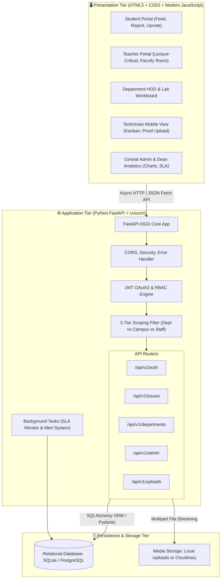
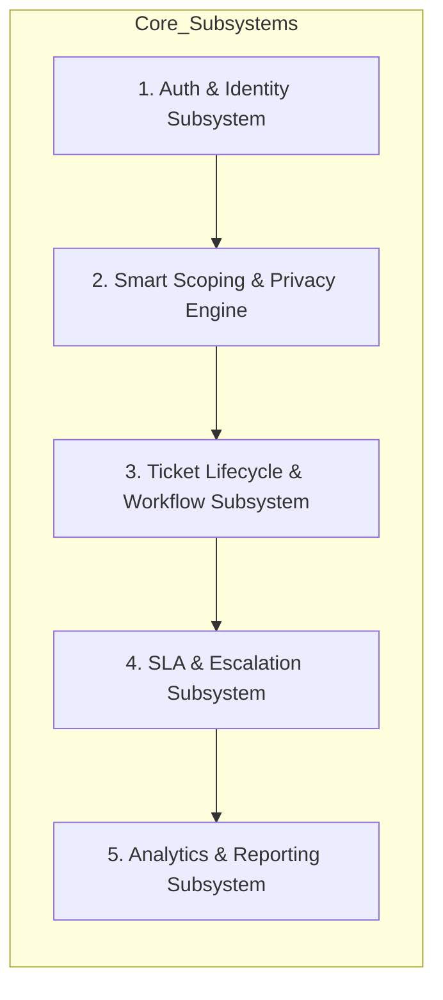
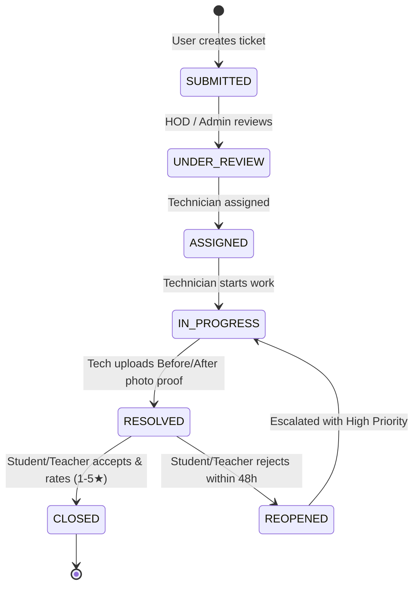
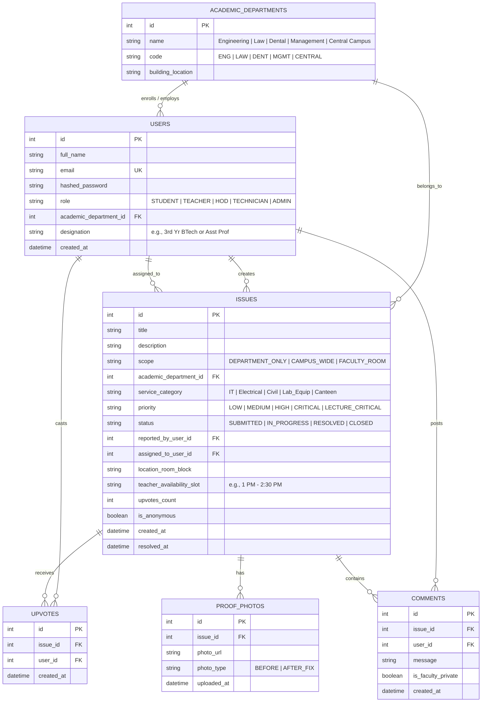

# 🏗️ High-Level Design (HLD) Document
## Project: CampusFix — Multi-Department College Issue Platform
**Tech Stack:** HTML5 / CSS3 / JavaScript (Frontend) + Python FastAPI (Backend)

---

## 1. System Overview & Architecture

CampusFix is designed using a **Clean 3-Tier Client-Server Architecture** optimized for high performance, ease of deployment, and academic evaluation.



---

## 2. Technology Stack Selection & Rationale

| Layer | Technology | Rationale & College Evaluation Benefit |
| :--- | :--- | :--- |
| **Frontend UI** | **HTML5, CSS3, Modern ES6+ JavaScript** | • Zero heavyweight build tools/node_modules complications.<br>• Native browser speed, lightweight, easy to run and showcase.<br>• Uses modern Fetch API for reactive REST calls. |
| **Styling** | **Modern CSS (Custom Design System + Flexbox/Grid)** | • Responsive design on smartphones and laptops.<br>• Modern clean card UI, badges, and modal dialogs. |
| **Backend API** | **Python FastAPI (v0.110+)** | • High performance asynchronous ASGI framework (built on Starlette & Pydantic).<br>• Automatic interactive Swagger UI documentation at `/docs` (professors love this in viva).<br>• Strong type checking and automatic JSON validation. |
| **Server Engine** | **Uvicorn** | Fast ASGI web server implementation for Python. |
| **ORM & Database**| **SQLAlchemy + SQLite (or PostgreSQL)** | • SQLite requires zero external server setup (ideal for demo).<br>• Clean schema definitions and automatic migration readiness. |
| **Authentication**| **OAuth2 with Password Flow + JWT (python-jose, passlib[bcrypt])** | Secure, stateless, industry-standard token authentication. |

---

## 3. Core Modules & Subsystem Design



### 3.1 Authentication & Role-Based Access Control (RBAC)
- **Token Format:** JSON Web Token (JWT) containing `user_id`, `role`, and `academic_department_id`.
- **Roles:**
  - `STUDENT`: Can report, upvote, track department & campus issues.
  - `TEACHER`: Can report lecture-critical issues, report private faculty room issues, sign off on repairs.
  - `HOD`: Department head oversight, assign lab assistants, monitor departmental SLAs.
  - `TECHNICIAN`: Claim tickets, log progress, upload resolution proof image.
  - `ADMIN`: University-wide view, department benchmarking, broadcast notices.

### 3.2 Smart Scoping & Privacy Engine (Crucial Logic)
Every ticket query passes through a scoping filter:
1. **Department-Only (`DEPARTMENT_ONLY`)**:
   - Query filtered by `academic_department_id == user.academic_department_id`.
   - Engineering students only see Engineering; Law students only see Law; Dental only sees Dental.
2. **Whole-College (`CAMPUS_WIDE`)**:
   - `scope == "CAMPUS_WIDE"`.
   - Visible to all authenticated users across the entire university (Central Library, Canteen, Bus, etc.).
3. **Faculty Room (`FACULTY_ROOM`)**:
   - `scope == "FACULTY_ROOM"`.
   - Filtered by `role in ['TEACHER', 'HOD', 'ADMIN', 'TECHNICIAN']`.
   - **Strictly invisible to students.**

### 3.3 Ticket Lifecycle & Workflow Subsystem



### 3.4 SLA & Escalation Subsystem
- **Priority Matrix:**
  - `LECTURE_CRITICAL` (Teacher in class): **15 Minutes**
  - `CRITICAL` (Hazard / Power outage / Water cut): **2 Hours**
  - `HIGH` (Lab machinery, Projector): **12 Hours**
  - `MEDIUM` (Furniture, Fan, Dispenser): **24 Hours**
  - `LOW` (Cosmetic, Non-urgent): **72 Hours**
- A lightweight background task runs periodically to check overdue tickets and flag them as `SLA_BREACHED`.

---

## 4. Database Schema Design (Entity-Relationship)



---

## 5. RESTful API Endpoint Architecture

| Method | Endpoint | Access Role | Description |
| :--- | :--- | :--- | :--- |
| `POST` | `/api/v1/auth/register` | Public | Register new Student or Teacher with institutional email |
| `POST` | `/api/v1/auth/login` | Public | Authenticate user & return JWT Bearer token |
| `GET` | `/api/v1/auth/me` | Authenticated | Get current user's profile, role & department |
| `GET` | `/api/v1/departments` | Public | List all academic departments (Engg, Law, Dental, etc.) |
| `GET` | `/api/v1/issues` | Authenticated | **Scoped feed**: Automatically returns dept/campus issues based on user role |
| `POST` | `/api/v1/issues` | Student / Teacher | Create new complaint (supports faculty room & lecture-critical tags) |
| `GET` | `/api/v1/issues/{id}` | Authenticated | View issue details, timeline, and discussion |
| `PUT` | `/api/v1/issues/{id}/status`| Technician / HOD / Admin | Update status (`IN_PROGRESS`, `RESOLVED`) |
| `POST` | `/api/v1/issues/{id}/proof` | Technician | Upload photo proof of completed repair |
| `POST` | `/api/v1/issues/{id}/upvote`| Student / Teacher | Upvote an existing complaint to prevent duplicates |
| `POST` | `/api/v1/issues/{id}/verify`| Student / Teacher | Final sign-off: Accept (1-5★) or Reopen within 48h |
| `GET` | `/api/v1/admin/dashboard` | Admin / HOD | Department analytics, SLA compliance, TAT metrics |
| `POST` | `/api/v1/admin/broadcasts`| Admin | Publish campus-wide maintenance/outage notice |

---

## 6. Recommended Project Directory Structure

```
Campus-Fix-College-issue-platform/
│
├── backend/                        # Python FastAPI Backend
│   ├── app/
│   │   ├── __init__.py
│   │   ├── main.py                 # FastAPI application initialization & routers mount
│   │   ├── config.py               # App configuration, secret keys, DB URI
│   │   ├── database.py             # SQLAlchemy engine & session maker
│   │   ├── models/                 # Database ORM models
│   │   │   ├── __init__.py
│   │   │   ├── user.py
│   │   │   ├── department.py
│   │   │   ├── issue.py
│   │   │   └── interaction.py     # Comments, Upvotes, Proofs
│   │   ├── schemas/                # Pydantic request/response schemas
│   │   │   ├── user.py
│   │   │   ├── issue.py
│   │   │   └── department.py
│   │   ├── routers/                # Modular API route controllers
│   │   │   ├── auth.py
│   │   │   ├── issues.py
│   │   │   ├── departments.py
│   │   │   └── admin.py
│   │   ├── services/               # Business logic & Scoping rules
│   │   │   ├── auth_service.py     # JWT & password hashing
│   │   │   ├── scoping_service.py  # Dept vs Campus vs Faculty Room filters
│   │   │   └── sla_service.py      # SLA escalation checks
│   │   └── uploads/                # Static folder for uploaded complaint & proof photos
│   ├── requirements.txt            # Python dependencies (fastapi, uvicorn, sqlalchemy, etc.)
│   └── seed_data.py                # Script to seed demo departments, students, teachers & tickets
│
├── frontend/                       # HTML5, CSS3 & JavaScript
│   ├── index.html                  # Landing page & unified login/register modal
│   ├── student-dashboard.html      # Student feed, report form, upvote panel
│   ├── teacher-dashboard.html      # Teacher portal (Lecture-critical, Faculty room, Sign-off)
│   ├── technician-workboard.html   # Maintenance staff Kanban & proof upload
│   ├── admin-dashboard.html        # Dean & HOD analytics, SLA alerts, broadcasts
│   │
│   ├── css/
│   │   ├── style.css               # Core styling, layout, variables, typography
│   │   ├── components.css          # Cards, badges, modals, buttons, forms
│   │   └── dashboard.css           # Grid layouts, Kanban columns, charts
│   │
│   └── js/
│       ├── api.js                  # Centralized Fetch API client with JWT handling
│       ├── auth.js                 # Login, signup, logout, session storage
│       ├── issues.js               # Issue submission, feed rendering, upvoting
│       ├── teacher.js              # Faculty-room forms, lecture-critical toggle
│       ├── technician.js           # Status updates, proof photo upload
│       └── admin.js                # Analytics rendering, broadcast publishing
│
├── README.md                       # Project overview & quickstart
├── REQUIREMENTS.md                 # Software Requirements Specification (SRS)
├── FEATURES.md                     # Comprehensive feature catalog
├── ACADEMIC_DEPARTMENTS_AND_FACULTY.md # Scoping & Teacher workflow design
└── HLD.md                          # High-Level Design Document (This file)
```

---

## 7. Security & Non-Functional Design

1. **Password Security:** Passwords hashed with `bcrypt` (12 rounds) before persisting. Plaintext passwords never stored.
2. **Stateless JWT Sessions:** Tokens stored in browser `localStorage` or `sessionStorage` and passed in `Authorization: Bearer <token>` header.
3. **File Upload Hardening:** Strict MIME type validation (JPEG, PNG, WebP only) and 5MB size limit to prevent server disk saturation.
4. **CORS Policy:** FastAPI `CORSMiddleware` configured to allow safe local development between frontend and backend ports.
5. **Fast Demo Execution:** The backend runs with a single command:
   ```bash
   uvicorn app.main:app --reload
   ```
   Interactive API docs immediately accessible at `http://127.0.0.1:8000/docs`.
