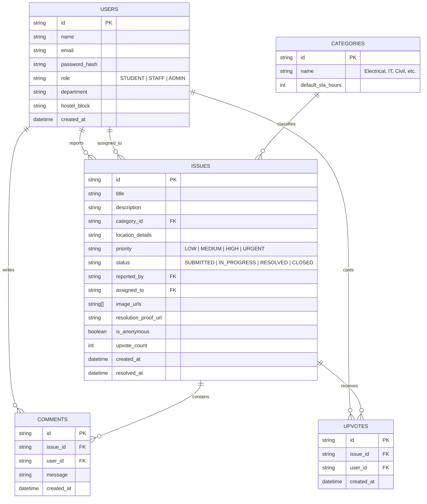

# Software Requirements Specification (SRS)
## Project Name: CampusFix — College Issue & Grievance Redressal Platform

---

### 1. Introduction & Background

#### 1.1 Problem Statement
In most colleges and university campuses, reporting infrastructure, academic, or residential grievances (such as broken lab equipment, electrical faults, plumbing leaks, Wi-Fi outages, and hygiene issues) is manual, slow, and fragmented. Existing methods rely on physical complaint registers, informal WhatsApp messages, or unmonitored email threads. Consequently:
- Issues get lost or delayed indefinitely.
- Students have zero visibility into grievance resolution status.
- Campus administration lacks centralized analytics to monitor maintenance performance and department accountability.

#### 1.2 Proposed Solution
**CampusFix** is a centralized, role-based web (and responsive mobile-friendly) application designed to streamline campus complaint reporting, automated routing, status tracking, and resolution verification with proof. It empowers students with transparency and gives college administration real-time insights into campus facility health.

---

### 2. Stakeholders & User Roles

| Role | Description | Core Capabilities |
| :--- | :--- | :--- |
| **Student / Faculty (Reporter)** | Any authenticated campus member reporting an issue | Single-window reporting with photos/location, upvoting, live tracking, rating resolutions. |
| **Department Head / Supervisor** | Leads for specific departments (IT, Electrical, Civil, Hostel, Sanitation, etc.) | Assign tickets to technicians, track departmental queues, manage spare parts, review SLAs. |
| **Technician / Ground Staff** | Assigned tradesmen (Electrician, Plumber, Systems Assistant, Carpenter) | View assigned tasks, add work logs, upload "before/after" fix proof, mark tickets resolved. |
| **Central Administrator (Dean / Estate Officer / Principal)** | Top-level authority overseeing campus-wide operations | Executive bird's-eye view of all departments, broadcast campus outages, handle inter-department hand-offs, export NAAC/UGC audit reports. |

---

### 3. Functional Requirements (FR)

#### Module 1: Whole-College (Campus-Wide) Features
- **FR-1.1 Single-Window Unified Student Portal**: Students report any issue through a single unified form without having to figure out which administrative office to visit; the system smartly classifies and routes the issue.
- **FR-1.2 Central Executive Dashboard**: Real-time cross-department monitoring, department performance league tables (TAT, resolution rate), and bottleneck alarms.
- **FR-1.3 Campus-Wide Outage & Maintenance Broadcasts**: Central admin can broadcast planned outages (e.g., power shutdown, water tank cleaning, Wi-Fi maintenance) which automatically aggregates and suppresses duplicate tickets.
- **FR-1.4 Inter-Department Composite Ticket Hand-Off**: Allows tickets requiring multiple trades (e.g., motor repair requiring both Civil and Electrical) to have primary and secondary assigned departments.
- **FR-1.5 Campus Infrastructure Health Index & Heatmap**: Aggregated health score per block/hostel with color-coded visual hotspot indicators.
- **FR-1.6 Statutory Audit Exporter (NAAC / UGC / NBA)**: One-click export of institutional grievance redressal metrics, time-to-resolution, and compliance reports.
- **FR-1.7 Academic Faculty Isolation (Engineering, Law, Dental, Physiotherapy, Sciences [B.Sc./M.Sc.], Masters [PG], Ph.D. Research)**: Issues specific to academic faculties are completely isolated to their respective students and teachers. Sciences students see wet lab/optics issues; Physiotherapy students see clinical electrotherapy/rehab gym issues; Masters students see PG seminar/thesis labs; Ph.D. scholars see 24x7 cubicle power and Central Instrumentation (CIF) issues without cross-faculty spam.

#### Module 2: Department-Wise Specialized Modules
The platform supports specialized sub-workflows for 10 college departments:
1. **IT & Campus Network**: Asset ID tracking (PC/Projector/AP), Wi-Fi dead-zone reports, network status indicator.
2. **Electrical & Power**: Emergency hazard alerts for exposed wires/sparks, spare parts inventory logging.
3. **Civil & Plumbing**: Water crisis fast-dispatch, mandatory before/after repair proof photos.
4. **Hostel & Residential Welfare**: Room/floor filtering, student availability inspection windows, geyser/cooler tracking.
5. **Sanitation & Housekeeping**: Fast-track 2-hour SLA for washrooms, supervisor digital rounds checklist.
6. **Academic Labs & Classrooms**: Faculty/Lab Assistant sign-off required before ticket closure.
7. **Library & Learning Resources**: Silent study noise reporting, OPAC & RFID gate tracking.
8. **Transport & Fleet**: Bus route and vehicle registration number linking, driver roster tracking.
9. **Canteen & Food Safety**: Automatic escalation of food hygiene issues to the Canteen Committee.
10. **Campus Security & Confidential Cell**: End-to-end encrypted vault for Anti-Ragging and harassment grievances.

#### Module 2: Issue Creation & Categorization
- **FR-2.1 Issue Reporting Form**:
  - Title and detailed description.
  - Category selection (e.g., Electrical, Plumbing, IT & Wi-Fi, Furniture/Civil, Cleaning & Sanitation, Mess/Hostel).
  - Exact Location tag (Campus Block / Floor / Room Number / Landmark).
  - Urgency/Priority level (Low, Medium, High, Emergency).
  - Media attachment: Image/photo upload (up to 3 photos, Max 5MB each).
- **FR-2.2 Anonymous Reporting Option**: Allow students to submit sensitive grievances (e.g., harassment, ragging, hostel safety) anonymously while retaining administrative audit trails.
- **FR-2.3 Duplicate Detection & Upvoting**:
  - Show public feed of existing open issues in the student’s hostel or campus zone.
  - Students can "Upvote / Me Too" an existing issue to boost its visibility instead of submitting duplicate tickets.
- **FR-2.4 Faculty Room & Staff Lounge Scope (Staff-Only)**:
  - Teachers can report issues specific to Faculty Cabins, Staff Lounges, and HOD Chambers (e.g., staff printers, cabin AC, furniture, staff washrooms).
  - These tickets are marked **Staff-Only** and are strictly hidden from student public feeds.
  - Includes a "Teacher Availability Slot" for technician visits so repairs do not disturb lectures or office hours.

#### Module 3: Workflow, Assignment & Status Tracking
- **FR-3.1 Status Lifecycle**:
  - `Submitted` $\rightarrow$ `Under Review` $\rightarrow$ `Assigned` $\rightarrow$ `In Progress` $\rightarrow$ `Resolved` $\rightarrow$ `Closed`.
- **FR-3.2 Automatic / Manual Department Routing**:
  - Tickets automatically route to designated department heads based on category.
  - Admin can manually reassign issues to specific technicians.
- **FR-3.3 Activity Timeline & Audit Log**:
  - Every status change, technician note, and timestamp is logged and viewable by both reporter and staff.
- **FR-3.4 Resolution Verification**:
  - Staff must upload proof of resolution (e.g., photo of repaired equipment) before marking an issue as `Resolved`.
  - Student can verify and mark `Closed` or `Reopen` within 48 hours if dissatisfied.

#### Module 4: Notifications & Communication
- **FR-4.1 In-App Notifications**: Real-time bell notification on status changes, comments, or assignments.
- **FR-4.2 Email Alerts**: Automated email notification on issue submission and resolution.
- **FR-4.3 Ticket Discussion Thread**: Lightweight comment thread on each ticket between reporter and assigned technician for clarification.

#### Module 5: Admin Analytics & Governance
- **FR-5.1 Central KPI Dashboard**:
  - Total issues reported, resolved, pending, and overdue.
  - Average Resolution Time (Turnaround Time / TAT).
  - Category-wise distribution (pie charts/bar graphs).
- **FR-5.2 SLA (Service Level Agreement) Escalation**:
  - Issues unresolved after a defined threshold (e.g., 48 hours for High priority) automatically flag as **Overdue** on the Admin dashboard.
- **FR-5.3 Exportable Reports**: Export complaint logs and monthly resolution statistics to CSV/PDF for college council reviews.

---

### 4. Non-Functional Requirements (NFR)

- **NFR-1 Usability & Responsiveness**: Mobile-first responsive UI (optimized for smartphones since most students take photos and report issues on phones).
- **NFR-2 Performance**:
  - Initial page load time $\le 2$ seconds.
  - Image upload compression before server storage to save bandwidth and storage.
- **NFR-3 Security & Privacy**:
  - Role-based route guards on all API endpoints.
  - Input sanitization against XSS and SQL/NoSQL injection.
  - Secure credential storage using modern hashing algorithms.
- **NFR-4 Data Integrity & Reliability**:
  - Soft-deletes for audit compliance (no accidental loss of complaint records).
  - 99% uptime during college operating hours.
- **NFR-5 Scalability**: System architecture able to support at least 2,000 active students and 100 concurrent requests.

---

### 5. Proposed Technology Stack

#### Recommended Option: Modern Full-Stack (MERN or Next.js)
- **Frontend**: React (Vite) or Next.js, Tailwind CSS, Lucide Icons, Shadcn UI / Chakra UI.
- **Backend**: Node.js + Express.js (or Next.js API Routes).
- **Database**: MongoDB (Mongoose) or PostgreSQL (Prisma ORM / Supabase).
- **File & Media Storage**: Cloudinary, AWS S3, or Supabase Storage for complaint images.
- **Authentication**: JWT with HTTP-only cookies or NextAuth / Firebase Auth.
- **Deployment**: Vercel / Netlify (Frontend) + Render / Railway (Backend) + MongoDB Atlas / Supabase (Database).

---

### 6. High-Level Entity-Relationship (Database Schema)

---

### 7. Implementation Roadmap & Phases

- **Phase 1 (Week 1–2): Foundation & Auth**
  - Database schema setup, User Auth (JWT/RBAC), basic layout and routing.
- **Phase 2 (Week 2–3): Core Issue Reporting & Feed**
  - Issue submission form with photo upload, public feed with filters (Category, Status, Location).
  - Upvote system and duplicate prevention.
- **Phase 3 (Week 3–4): Technician & Admin Workflows**
  - Department dashboard, ticket assignment, status transition flow with proof upload.
- **Phase 4 (Week 4–5): Analytics, SLA & Notifications**
  - Admin charts (Chart.js / Recharts), SLA overdue highlights, email notifications.
- **Phase 5 (Week 5–6): Testing, Polish & College Presentation Prep**
  - UI refinement, mobile responsiveness check, seed demo data, project report & presentation slides.
